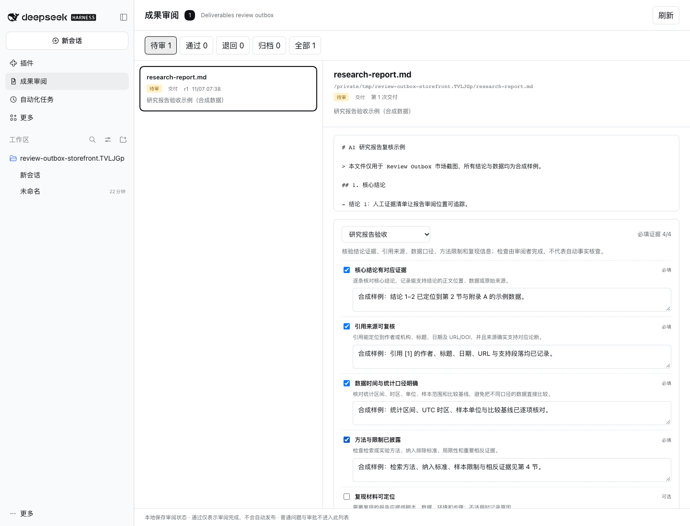

# Review Outbox — deliverable review for DeepSeek Harness

[Awesome listing](https://awesome-dsh-plugin.com/p/zjukop3/dsh-review-outbox/) · [Research checklist](https://zjukop3.github.io/dsh-review-outbox/research-report/) · [Download 0.1.0](https://zjukop3.github.io/dsh-review-outbox/downloads/dsh-review-outbox-0.1.0.tgz) · [安装说明 / Chinese guide](README.md)

Review Outbox is a local-first review workbench for files produced by DeepSeek Harness agents. It collects real deliverables, supports evidence-based research-report acceptance, records revisions and SHA-256 evidence, and exports standalone HTML review receipts that recipients can open without installing anything.

It handles **deliverable disposition**, not generic notifications, questions, or tool approvals. Approval records a human review decision; it never auto-publishes the artifact or rewrites the source Session.



## Features

- Ingests official `deliverables/presented` events, including bounded historical Session backfill.
- Automatically ingests `report.md` and `manifest.json` from successful [`dsh-research-report`](https://github.com/PerryLink/dsh-research-report) `research_report` results, without requiring an additional `present` call.
- Preserves one artifact across different real `callId` values and turns later deliveries into revisions.
- Text and common image previews, plus official `workspace/changes` diffs while the source Session remains available.
- Opens DOCX and PDF artifacts through the official DSH document Viewer after restoring the source Session.
- Research-report acceptance pack: claim evidence, citation review, data scope, and method limitations are required; reproduction materials are optional.
- Required checks need both a checked state and a reviewer-written evidence note before approval.
- Approve, return, archive, and reopen with notes and durable history.
- SHA-256 evidence on approval or return, with a visible warning if the artifact changes afterward.
- Standalone, script-free HTML receipts with no local absolute paths or Session content.
- Atomic local JSON writes and read-only protection when state is corrupt.
- Optional `dsh-better-sidebar` bottom-tab integration with service-lifecycle cleanup; the native sidebar remains available without it.

## Status

Version `0.1.0` is in validation. Source code, the research-checklist site, and the [Awesome catalog listing](https://awesome-dsh-plugin.com/p/zjukop3/dsh-review-outbox/) are public. npm and GitHub Releases remain unpublished. Listing is a discovery milestone, not evidence of organic activation or retention. New receipts link to the public GitHub repository.

Target runtime: DeepSeek Harness `>=0.2.2-rc.1 <0.3.0-0`, Node.js `>=22.19`.

See [verified compatibility](docs/COMPATIBILITY.md) for the exact environments that have been exercised.

## Install

For application-native discovery, enable **Custom plugin index** under **Plugins**, open **Discover**, and add:

```text
https://zjukop3.github.io/dsh-review-outbox/plugins.json
```

Search for `Review Outbox` or `研究报告`, verify the version and full commit, install, then enable the plugin under **Installed**. The `format: 1` index is validated with the official DSH parser; see the [application market guide](docs/MARKET.md).

Alternatively, copy the command from the [Awesome listing](https://awesome-dsh-plugin.com/p/zjukop3/dsh-review-outbox/), or run the exact verified catalog command:

```bash
dsh plugin --profile web add github:zjukop3/dsh-review-outbox
dsh web
```

The fresh isolated Profile resolved this command to `2e8cb8d1f5b7237a6ad1159e6ae027b3cd6a5700`.

Alternatively, install directly from the public GitHub repository, also verified in a fresh isolated Profile:

```bash
dsh plugin --profile web add https://github.com/zjukop3/dsh-review-outbox
dsh web
```

The lockfile records the resolved commit. Commit `ac8246501e5009a8323b33ab39559bce191671ee` passed historical backfill, text preview, and native-sidebar checks. See [verified compatibility](docs/COMPATIBILITY.md).

Alternatively, download [Review Outbox 0.1.0](https://zjukop3.github.io/dsh-review-outbox/downloads/dsh-review-outbox-0.1.0.tgz) and its [SHA-256 file](https://zjukop3.github.io/dsh-review-outbox/downloads/dsh-review-outbox-0.1.0.tgz.sha256). Run `shasum -a 256 -c dsh-review-outbox-0.1.0.tgz.sha256` in the download directory, then install into an isolated Web Profile:

```bash
dsh plugin --profile web add /absolute/path/dsh-review-outbox-0.1.0.tgz
dsh web
```

To install from a local source directory instead:

```bash
dsh plugin --profile web add /absolute/path/dsh-review-outbox
dsh web
```

For a tarball installation and recovery procedure, read [installation and recovery](docs/INSTALL-RECOVERY.md).

## Research-report acceptance workflow

1. Let the agent deliver through the official `present` tool, or generate a sealed report with `dsh-research-report`. Both paths enter the same review workbench.
2. Open **Review Outbox / 成果审阅**.
3. Select the artifact and the **Research report acceptance / 研究报告验收** pack.
4. Record evidence for all four required checks. Approval remains blocked when a required check lacks either its checked state or evidence text.
5. Approve or return with review notes. A new delivery of the same artifact creates a new revision and clears the previous check states.
6. Export the standalone HTML receipt. If the current file digest differs from the reviewed digest, the receipt asks for another review.

The [research-report checklist](docs/packs/research-report.md) is useful even without installing the plugin. Real Cordis/Session/tool-pipeline interoperability with `dsh-research-report@0.3.32` is recorded in [validation evidence](docs/VALIDATION.md): sealed artifacts are discovered automatically, retain their result-event coordinates, and can complete evidence-based review and receipt export.

## Viewer support

The panel does not embed its own Office or PDF renderer. **Open in host Viewer / 在宿主 Viewer 打开** restores the source Session and calls the official `sidebarRight` document router. Real DOCX and PDF flows have been verified with Chinese text and tables. PPTX/XLSX, encrypted PDFs, missing-font cases, and very large documents still need verification.

## Local state and recovery

Review state is stored at:

```text
$DSH_HOME/review-outbox/items.json
```

When `DSH_HOME` is unset, the default is `~/.dsh/review-outbox/items.json`. Files use mode `0600`.

The plugin does not create automatic backups. Stop the Profile before backing up or restoring state. Corrupt state becomes read-only, mutations return 400, backfill reports failure, and the original bytes are preserved. See [installation and recovery](docs/INSTALL-RECOVERY.md).

## Verification

```bash
pnpm install --ignore-scripts
pnpm test
pnpm run build
```

The suite currently contains **45 tests**, passing on Node.js 22.19.0 and 25.2.1. Coverage includes real execution of the official `present` tool, production-default Zstandard JSONL persistence, cold reads, resumed-Session revisions across different `callId` values, Host authorization, receipt injection checks, and native Viewer address routing.

Run the separate real two-plugin interoperability check after installing the external checkout's frozen dependencies:

```bash
DSH_RESEARCH_REPORT_CHECKOUT=/absolute/path/dsh-research-report pnpm run test:interop:research
```

This uses real Cordis, SessionStore, ToolRuntime, and `research_report` execution in isolated temporary directories. It is not counted among the 45 tests and does not claim a full Web GUI or external-user trial.

Additional real-browser evidence covers research acceptance, receipt downloads, changed-artifact detection, DOCX/PDF viewing, `dsh-better-sidebar@0.30.0` interoperability and hidden-tab polling, a 20-artifact dogfood pass, clean tarball installation, restart, and corrupt-state recovery. See [validation evidence](docs/VALIDATION.md) and the [dogfood report](docs/DOGFOOD.md).

## Natural distribution

The project includes a static, offline research-checklist site with structured FAQ/TechArticle metadata and a real receipt example. It is designed for search and artifact-led discovery rather than mandatory social promotion. The site is deployed on GitHub Pages; public deployment alone is not evidence of organic traffic or activation. See [distribution](docs/DISTRIBUTION.md).

## Limitations

- Historical backfill reads only `deliverables/presented` and matched successful `research_report` call/result pairs, with explicit Session, event, and item limits. A result whose call falls outside the selected event tail is not guessed to be a research report.
- Old workspace diffs are not guaranteed after the source Session is gone; review metadata and evidence persist.
- The research pack records human review evidence; it does not fetch citations or claim automatic fact-checking.
- Receipts are generated locally and are never automatically uploaded. Reviewer-written evidence and notes are included when exported.
- External-user retention and organic activation remain unverified.

## License

MIT
