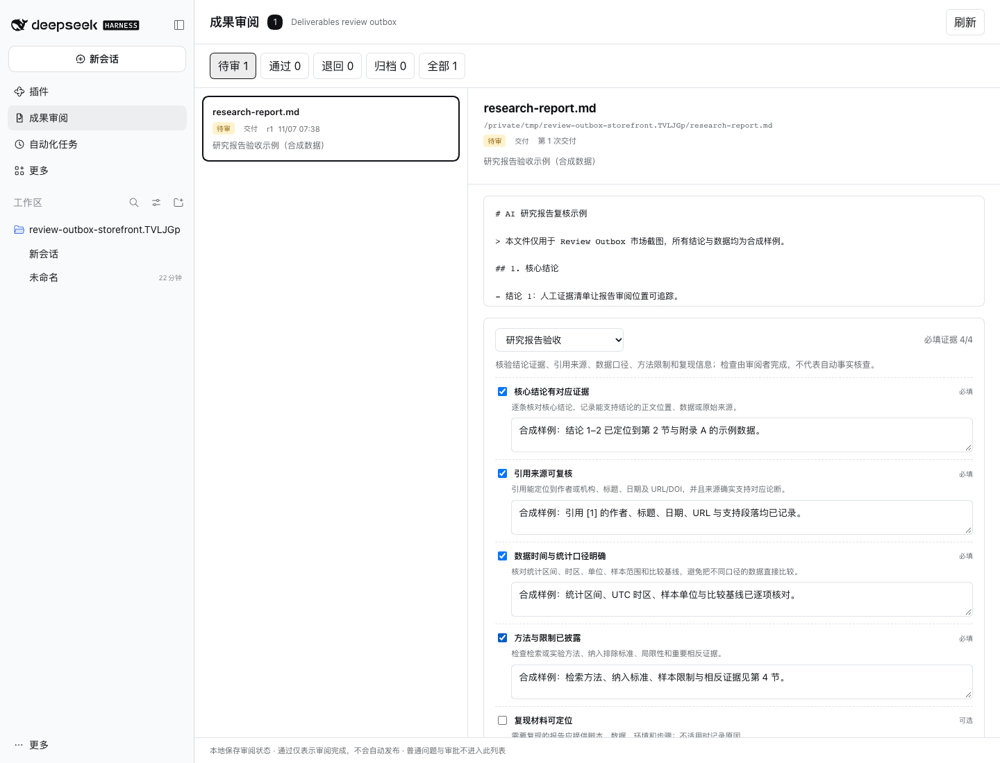

# Review Outbox · 成果审阅与研究报告验收

中文 | [English](README.en.md) | [应用内安装 0.1.2](#从应用内发现安装) | [Awesome 目录](https://awesome-dsh-plugin.com/p/zjukop3/dsh-review-outbox/) | [在线验收清单](https://zjukop3.github.io/dsh-review-outbox/research-report/) | [旧版 0.1.0 tarball](#下载-tarball)

一个本地优先的 DeepSeek Harness 成果审阅插件：把 Agent 交付的文件集中起来，完成预览、场景化证据检查、通过、退回、归档和复盘，并可导出无需安装即可查看的独立 HTML 验收单。

它处理的是**成果处置**，不是普通问题、审批或通知。通过只表示你已完成审阅，插件不会自动向外部平台发布，也不会自动改写原会话。

**0.1.2 首次价值已在真实 Web GUI 跑通**：从公开 GitHub 安装固定提交后，安装前密封报告自动回填，默认显示 `必填证据 0/4`，四项证据完成后通过并下载独立验收单；验收单入口直接回到公开安装指南。查看[结构化证据](docs/e2e/application-first-value.json)与[实际下载的验收单](docs/e2e/application-first-value.review.html)。



## 当前范围

- 监听官方 `deliverables/presented`，逐项记录交付文件、来源会话、轮次、调用和 revision。
- 同时启用 [`dsh-research-report`](https://github.com/PerryLink/dsh-research-report) 时，自动把成功 `research_report` 结果中的 `report.md` 与 `manifest.json` 加入审阅队列；不要求它额外调用 `present`。
- 在官方 `workspaceChanges` 服务可用时接收 `workspace/changes`，按需读取变更对比。
- 文本与常见图片预览；工作区变更在官方仍提供数据时显示 diff。
- PDF、DOCX 等成果可恢复来源 Session 并调用官方 `sidebarRight` 文档 Viewer，复用宿主 Office 转 PDF 和 PDF.js 能力。
- 通过、退回、归档、重新打开，保存审阅意见和完整处理历史。
- 研究报告验收包：密封报告默认附带，核心结论证据、引用复核、数据口径、方法限制为必填检查，复现材料为可选检查；必须勾选并填写证据才能通过。可更换或清除验收包，重复回填不会覆盖用户选择。
- 通过和退回时记录文件 SHA-256；独立 HTML 验收单包含检查证据、revision、意见和历史，导出时检测文件是否在审阅后变化。
- 启动时从官方 `sessionPersistence` 有界回填历史 `deliverables/presented` 和可配对的密封研究结果，安装前的交付也能进入审阅队列。
- 同一路径再次交付形成新 revision；已审阅状态不会被无变化的重新发现或重复回填重置。
- 本地 JSON 原子写入，损坏时进入只读保护。
- 可以复制退回意见并打开来源会话；不会自动向会话发送内容。
- 可选接入 `dsh-better-sidebar` 底部标签页；服务未安装时不影响原生侧栏，服务替换或移除时同步清理注册。

## 明确边界

- 普通问题、工具审批和通知不进入此列表，避免与 DeepCanary 等产品重叠。
- 历史回填只读取 `deliverables/presented` 与成功 `research_report` 的调用/结果对，默认扫描最新 50 个 Session、每个最多读取末尾 5000 个事件、每轮最多入库 1000 项；调用不在同一读取窗口时不会凭结果元数据猜测工具名。达到上限或单个 Session 读取失败会在 `backfill` 状态中明确显示。
- `workspace/changes` 仍只接收插件启用后观察到的事件，其摘要和 diff 主要服务仍存活的会话；重启后保留本插件的成果元数据与审阅状态，但不承诺旧 diff 仍可读取。
- 预览只接受已登记成果，并默认限制在记录的工作区内；不支持任意本地路径读取。
- 本面板不内嵌 Office/PDF 渲染器；可点击「在宿主 Viewer 打开」，先恢复来源 Session 再进入官方预览。实际格式支持以宿主 Viewer 为准。
- 研究报告包记录人工检查证据，不自动访问引用，也不冒充自动事实核查。
- 验收单默认在本地导出，不自动上传；不包含绝对路径或会话内容，检查证据和审阅意见按用户填写内容导出。
- 项目处于 0.1.x 验证阶段；当前源码与应用内索引为 0.1.2，Pages tarball 仍为 0.1.0。GitHub 源码、Pages 清单和 [Awesome 目录条目](https://awesome-dsh-plugin.com/p/zjukop3/dsh-review-outbox/)已公开，npm 和 GitHub Release 尚未发布。目录收录不等于自然流量或真实采用。新生成的验收单默认链接到公开安装指南。

## 安装

目标宿主：DeepSeek Harness `>=0.2.2-rc.1 <0.3.0-0`；Node.js `>=22.19`。实测范围见[兼容矩阵](docs/COMPATIBILITY.md)，tarball 安装、备份、升级与损坏恢复见[安装恢复指南](docs/INSTALL-RECOVERY.md)。

### 从应用内「发现」安装

在「插件」中启用「自定义插件索引」，进入「发现」并添加以下索引源，然后搜索 `Review Outbox` 或 `研究报告`：

```text
https://zjukop3.github.io/dsh-review-outbox/plugins.json
```

确认版本和完整提交后安装，再回到「已安装」启用插件。该 `format: 1` 索引由宿主官方解析器验证，详见[应用内市场指南](docs/MARKET.md)。

应用内网络不可用时，可对同一个 `0.1.2` 公开提交使用 CLI 回退：

```bash
dsh plugin --profile web add 'github:zjukop3/dsh-review-outbox#e9bb649d515a38de0f61226980f40e3d45173f1d'
dsh web
```

### 从 Awesome 目录安装

打开[公开目录条目](https://awesome-dsh-plugin.com/p/zjukop3/dsh-review-outbox/)复制命令，或执行：

```bash
dsh plugin --profile web add github:zjukop3/dsh-review-outbox
dsh web
```

该目录原样命令已在全新隔离 Profile 实测并解析到 `2e8cb8d1f5b7237a6ad1159e6ae027b3cd6a5700`。

### 从公开 GitHub 仓库安装

以下直装方式已在全新隔离 Profile 实测：

```bash
dsh plugin --profile web add https://github.com/zjukop3/dsh-review-outbox
dsh web
```

锁文件会记录实际解析的提交；本次验证了公开提交 `ac8246501e5009a8323b33ab39559bce191671ee` 的历史回填、文本预览和原生侧栏。详见[兼容矩阵](docs/COMPATIBILITY.md)。

### 下载 tarball

下载 [Review Outbox 0.1.0](https://zjukop3.github.io/dsh-review-outbox/downloads/dsh-review-outbox-0.1.0.tgz) 和对应的 [SHA-256 文件](https://zjukop3.github.io/dsh-review-outbox/downloads/dsh-review-outbox-0.1.0.tgz.sha256)，在安装目录执行 `shasum -a 256 -c dsh-review-outbox-0.1.0.tgz.sha256`，然后安装到独立 Web Profile：

```bash
dsh plugin --profile web add /absolute/path/dsh-review-outbox-0.1.0.tgz
dsh web
```

也可以从本地源码目录安装：

```bash
dsh plugin --profile web add /absolute/path/dsh-review-outbox
dsh web
```

桌面端请使用应用管理的插件安装界面，不直接修改桌面 Profile。

## 使用

研究报告的完整清单、证据示例和独立验收单说明见[研究报告验收包](docs/packs/research-report.md)。与 `dsh-research-report@0.3.32` 的真实 Cordis/Session/工具管线互操作已验证：密封结果自动入库，报告与 manifest 保留来源事件坐标，随后可完成证据检查和验收单导出；见[联合验证](docs/VALIDATION.md#dsh-research-report-真实互操作)。

1. 让 Agent 正常完成任务并通过官方 `present` 交付文件，或使用 `dsh-research-report` 生成密封研究报告。
2. 打开侧栏「成果审阅」。
3. 在「待审」中选择成果，检查内容或变更；密封研究报告已默认附带「研究报告验收」，逐项填写证据，也可更换或清除验收包。
4. 选择「通过」「退回」或「归档」。退回时先写明修改意见；场景包必填证据不足时不能通过。
5. 通过后点击「导出验收单」，得到可独立打开和随成果分享的 HTML；如果文件审阅后变化，验收单会明确提示。
6. 需要继续修改时，点击「复制意见并打开原会话」，在新消息中粘贴并继续。

状态、revision、意见和历史保存在：

```text
$DSH_HOME/review-outbox/items.json
```

未设置 `DSH_HOME` 时默认是 `~/.dsh/review-outbox/items.json`。文件权限为 `0600`，目录按当前系统用户创建。

## 开发

```bash
pnpm install --ignore-scripts
pnpm test
pnpm run build
```

- `src/events.js`：官方事件到成果记录的纯转换。
- `src/backfill.js`：最新 Session 优先的有界读取、单会话故障隔离和句柄释放。
- `src/store.js`：串行状态变更、验收包、revision、历史和原子持久化。
- `src/packs.js`：研究报告检查项、证据进度与 Host 通过约束。
- `src/evidence.js`：受工作区约束的文件 SHA-256 证据。
- `src/receipt.js`：无脚本、无外部依赖的独立 HTML 验收单。
- `src/preview.js`：工作区约束、文本/图片预览与大小限制。
- `src/host.js`：Host 事件监听和经 Connection 鉴权的 HTTP API。
- `client/`：侧栏主面板、审阅交互与 `native-open.js` 官方文档 Viewer 路由。
- `test/`：数据层、Host 集成、状态与预览测试。

### 合成示例

```bash
export DSH_HOME=/tmp/dsh-review-outbox-e2e
export DSH_REVIEW_OUTBOX_DEMO_DIR=/absolute/path/dsh-review-outbox/demo
dsh plugin --profile web add /absolute/path/dsh-review-outbox
dsh web --no-open --port 43177
```

示例只读取 `demo/` 下的合成文件，不扫描其他目录。正常安装不包含示例数据。

### 浏览器验证

启动上面的隔离实例后，将打印出的完整 URL 传入：

```bash
export DSH_E2E_URL='http://127.0.0.1:43177/?token=<token>'
node scripts/e2e-browser.mjs
```

脚本使用本机 Chrome，处理首次启动的预览说明和可选登录模态，验证侧栏、选择成果、预览、点击通过以及 API 状态回写。截图和结果保存在 `docs/e2e/`。

### 真实研究插件互操作

先在独立检出中安装 `dsh-research-report` 的冻结依赖，再运行：

```bash
DSH_RESEARCH_REPORT_CHECKOUT=/absolute/path/dsh-research-report pnpm run test:interop:research
```

脚本通过真实 Cordis、SessionStore、ToolRuntime 和 `research_report` 工具管线生成密封报告，验证自动入库、预览、人工证据验收和独立验收单。它使用隔离临时目录，不连接日常 Profile，也不冒充完整 Web GUI 或外部用户验证。

### 完整检查

```bash
pnpm run check
```

当前单元、Host、官方工具、站点构建与市场素材集成测试共 45 项，Node.js 22.19.0 与 25.2.1 均通过。其中 `test/official-present.test.js` 直接执行官方 `present`，经生产默认的 Zstandard JSONL 落盘、关闭写入上下文、冷读后进入回填；另一测试从同一 JSONL Session 恢复，以不同 `callId` 再次交付并验证只形成一条 revision 历史。独立的真实双插件互操作脚本不计入这 45 项。公开应用内索引的「发现 → 搜索 → 安装 → 启用 → 原生侧栏」流程已单独通过，见[应用内市场指南](docs/MARKET.md)。真实挂载和浏览器验证记录见 [验证文档](docs/VALIDATION.md)。

## API

所有路由都要求 DSH Connection 鉴权，不提供无鉴权端点。

| 方法 | 路径 | 用途 |
|---|---|---|
| GET | `/review-outbox/api/health` | 健康检查与当前统计 |
| GET | `/review-outbox/api/items?status=pending` | 按状态列出成果与验收包进度 |
| GET | `/review-outbox/api/packs` | 可用场景验收包及检查定义 |
| GET | `/review-outbox/api/item?id=<id>` | 单项元数据 |
| GET | `/review-outbox/api/preview?id=<id>` | 文本或图片预览 |
| GET | `/review-outbox/api/diff?id=<id>` | 官方仍可用时的变更对比 |
| GET | `/review-outbox/api/receipt?id=<id>` | 下载独立 HTML 验收单并复核当前文件摘要 |
| POST | `/review-outbox/api/pack` | 选择或清除场景验收包 |
| POST | `/review-outbox/api/check` | 保存检查勾选和证据说明 |
| POST | `/review-outbox/api/backfill` | 按既定上限重新执行历史回填并返回状态 |
| POST | `/review-outbox/api/action` | `approve` / `return` / `archive` / `reopen` |

动作请求：

```json
{"id":"presented:...","action":"return","note":"请补充来源与复现步骤"}
```

## 参与方向

北极星指标是**每周被真正审阅并处置的成果数**，不是安装量。自然获客不依赖维护者持续发帖，而是通过可搜索的场景验收包、随成果分享且无需安装即可查看的独立验收单，以及官方 `present` 的零配置接入形成增长环。

**其他插件作者**：你们的产出只要走官方 `present` 就会自动进入审阅队列，`dsh-research-report` 密封结果还会自动附带研究报告验收包，无需任何适配代码。接入规则、边界与自查步骤见[插件作者集成指南](docs/INTEGRATION.md)。

详见 [长期路线](docs/STRATEGY.md) 与 [目录收录准备](docs/CATALOG.md)。

## License

MIT
