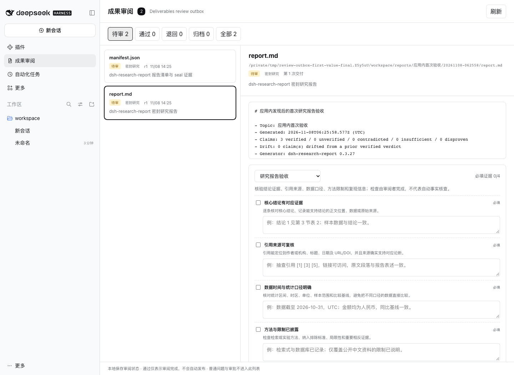

# DeepSeek Harness 研究报告验收清单与 Review Outbox 验收包

适用于 AI 研究报告、文献综述、市场调研、技术调研和带引用的分析文档。核心问题是：**模型说“已完成”之后，审阅者怎样确认结论、引用、数据口径和方法限制真的经过复核？**

Review Outbox 将下面这份清单变成持久化检查项、通过条件和独立 HTML 验收单。即使不安装插件，也可以直接复制清单使用。

## 四项必填检查

- [ ] **核心结论有对应证据**：逐条核对核心结论，记录支持结论的正文位置、数据或原始来源。
- [ ] **引用来源可复核**：引用能定位到作者或机构、标题、日期及 URL/DOI，并确认原文确实支持对应论断。
- [ ] **数据时间与统计口径明确**：核对统计区间、时区、单位、样本范围和比较基线。
- [ ] **方法与限制已披露**：检查检索或实验方法、纳入排除标准、局限性和重要相反证据。

在插件中，仅勾选还不够；每项都必须填写可定位、可复核的证据说明，才能完成“通过”。

## 一项可选检查

- [ ] **复现材料可定位**：需要复现的报告提供脚本、数据、环境和步骤；不适用时记录原因。

## 在 Review Outbox 中使用

1. 让 Agent 正常完成报告，通过官方 `present` 或 `dsh-research-report` 密封结果交付。
2. 打开「成果审阅」选择报告；密封研究报告已默认附带「研究报告验收」。
3. 阅读报告，逐项填写证据；勾选表示已完成该项人工检查。
4. 四项必填证据齐全后通过；需要返工时填写退回意见。
5. 通过后导出独立 HTML 验收单，与报告一起提供给成果接收者。

插件也接收安装前持久化 Session 中的官方交付和可配对的 `research_report` 密封结果，不要求上游研究插件专门适配。DOCX 和 PDF 可以恢复来源 Session 后进入官方 Viewer，不需要另行安装渲染器。

## 已验证的首次价值

真实 Chrome 已在隔离 Profile 中完整验证：安装前生成的密封研究报告，在固定提交安装后自动回填；报告默认显示 `必填证据 0/4`，完成四项证据后通过并下载独立验收单。manifest 同时回填，但不会误附研究报告验收包。



[查看这次首次价值验证的结构化证据](https://github.com/zjukop3/dsh-review-outbox/blob/main/docs/e2e/application-first-value.json)。它证明合成固定证据在真实插件、持久化和 Web GUI 中的完整产品链路，不把验证环境算作外部用户。

## 直接查看真实验收单

[打开一份由真实浏览器流程导出的研究报告验收单](receipt-example.html)。它展示了检查证据、revision、审阅意见、处理历史和文件摘要，不需要安装 DeepSeek Harness 或 Review Outbox。

## 验收单包含什么

- 报告文件名、revision、状态和审阅意见
- 每项检查的完成状态与证据说明
- 处理历史
- 通过或退回时的文件 SHA-256
- 导出时文件与审阅时摘要是否一致
- Review Outbox 插件入口

验收单是无脚本、无外部资源的独立 HTML，接收者无需安装即可打开。它不自动上传，不写入原报告，不包含本机绝对路径或会话内容；证据与意见按审阅者填写内容导出。

## 安装 Review Outbox 0.1.5

目标宿主为 DeepSeek Harness `>=0.2.2-rc.1 <0.3.0-0`，Node.js `>=22.19`。项目处于 `0.1.x` 验证阶段，[GitHub 源码](https://github.com/zjukop3/dsh-review-outbox)与 Pages 清单已公开；npm 和 GitHub Release 尚未发布，[Awesome 社区目录](https://awesome-dsh-plugin.com/p/zjukop3/dsh-review-outbox/)已合并收录。

### 从应用内「发现」安装

1. 打开「插件」，启用实验性「自定义插件索引」。
2. 进入「发现 → 添加索引源」，添加以下地址：

```text
https://zjukop3.github.io/dsh-review-outbox/plugins.json
```

3. 搜索 `Review Outbox` 或 `研究报告`，确认版本 `0.1.5`、仓库和完整提交后安装。
4. 回到「已安装」，启用 `dsh-review-outbox`；左侧出现「成果审阅」后即可使用。


### 使用固定提交 CLI 安装

应用内安装网络不可用时，可对同一个公开提交执行：

```bash
dsh plugin --profile web add 'github:zjukop3/dsh-review-outbox#bdcd446863e3c79d359871cb159d4fc120586a6f'
dsh web
```

### 旧版 tarball

Pages 仍保留 [0.1.0 tarball](https://zjukop3.github.io/dsh-review-outbox/downloads/dsh-review-outbox-0.1.0.tgz) 和 SHA-256 校验文件，用于复现旧版安装；它不包含 `0.1.1` 的密封报告默认验收包行为。新生成的验收单默认链接到 GitHub 仓库。

## 常见问题

### 为什么只勾选检查项还不够？

勾选只表示“认为完成了”，证据说明才能定位到具体章节、数据、引用或复现材料。Review Outbox 要求四项必填检查同时具有勾选和证据文本，避免验收流形式化。

### 验收单会自动上传报告吗？

不会。验收单在本地生成，不自动上传，也不自动包含成果正文、绝对路径或会话内容。你填写的检查证据和审阅意见会进入验收单，分享前应像检查任何交付物一样复核这些内容。

### 审阅后报告又发生变化怎么办？

通过或退回时插件记录文件 SHA-256。导出验收单时会重新计算摘要；如果当前文件与审阅时不一致，页面会显示“文件在审阅后发生变化，请重新审阅当前版本”。

### 没有 DeepSeek Harness 能使用这份清单吗？

可以。清单本身可以直接复制使用，独立验收单也无需安装即可阅读。只有自动记录检查状态、通过条件、revision、文件摘要和后续验收单导出需要插件。

## 边界

本验收包记录的是**人工审阅证据**，不会自动访问 URL、验证 DOI、判断来源真伪或替代领域专家。DOCX/PDF 预览由宿主 Viewer 提供；PPTX/XLSX、密码保护 PDF 和超大文件仍需继续验证。

## English research report acceptance checklist

**Research report acceptance checklist for DeepSeek Harness:** verify claims against evidence, inspect citations, confirm data scope and dates, disclose methods and limitations, record reproduction materials, and export a standalone SHA-256 review receipt.

- Map every material claim to a section, dataset, or primary source.
- Check author or organization, title, publication date, URL or DOI, and the original supporting passage.
- Confirm reporting period, time zone, units, sample frame, and comparison baseline.
- Document search or experiment methods, inclusion criteria, limitations, and material counter-evidence.
- Record scripts, data, environment, and reproduction steps when applicable.

Review Outbox ingests official `present` deliveries and sealed `dsh-research-report` results, then stores human review evidence; it does not claim automatic fact-checking. The standalone receipt works without installation and warns when the artifact changes after review.
